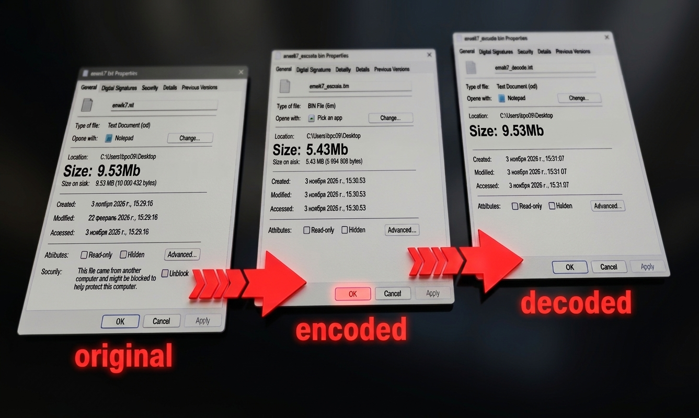

# Lossless Data Compression

Реализация и исследование базовых алгоритмов сжатия данных без потерь 
на C++. Включает 9 компрессоров на основе RLE, BWT, MTF, LZW, LZSS 
и алгоритма Хаффмана.

## Задача

Реализовать базовые алгоритмы сжатия (RLE, BWT, MTF, группы LZ, Huffman, 
Arithmetic coding) с нуля, собрать из них 9 комбинированных компрессоров 
и провести исследование: как размер буфера/словаря/блока влияет 
на коэффициент сжатия и скорость работы.

## Реализация

Все алгоритмы работают с бинарными данными (`std::vector<uint8_t>`), 
каждый вынесен в отдельный класс в своей папке. Сборка компрессоров — 
через CMake (`compressors/`).

### Кодирование повторов

- **RLE** — базовая версия: серия одинаковых байтов кодируется парой 
  «символ + количество». Простой, но на неоднородных данных может 
  увеличивать размер.
- **RLE-flag** — усовершенствованная версия: старший бит байта — маркер 
  серии или одиночного символа. Позволяет не увеличивать данные, где мало повторов.
- **RLE-group** — групповая версия: серии кодируются блоками, что даёт 
  выигрыш на длинных однородных участках.

### Перестановки и преобразования

- **BWT** (Burrows–Wheeler Transform) — перестраивает строку так, что 
  одинаковые символы встают рядом. Сам по себе не сжимает, предназначен 
  для оптимизации данных для последующего сжатия алгоритмами RLE и MTF.
  Реализован двумя способами: через матрицу сдвигов (наглядно, O(n²) по
  памяти) и через суффиксный массив (быстрее).
- **MTF** (Move-To-Front) — преобразует строку в последовательность 
  маленьких чисел: каждый символ заменяется на его индекс в словаре, 
  после чего символ перемещается в начало. Хорошо работает после BWT.

### Словарные методы (семейство LZ)

- **LZ77** — кодирует повторения фраз триплетами «смещение, длина, 
  следующий символ». Простой, но на данных без повторов увеличивает 
  строку в 3 раза.
- **LZ78** — строит словарь фраз по мере чтения: каждая новая фраза = 
  «код предыдущей фразы + новый символ». Не требует скользящего окна.
- **LZSS** — модернизация LZ77: вместо триплетов использует маркерные 
  биты и пары «смещение, длина», а одиночные символы кодирует отдельно. 
  Оптимальный размер буфера — 16 КБ (по результатам исследования).
- **LZW** — развитие LZ78: словарь инициализируется всеми символами 
  алфавита, коды фиксированной длины (2 байта, до 64 КБ). Оптимальный 
  размер словаря — 64 КБ.

### Энтропийное кодирование

- **Huffman** — строит дерево по частотам символов: частым символам — 
  короткие коды, редким — длинные. В результат сохраняется словарь 
  (символ + длина кода), по нему восстанавливается дерево при 
  декодировании.
- **Arithmetic** — арифметическое кодирование: вся строка представляется 
  одним дробным числом в интервале [0, 1). Точнее Хаффмана, но сложнее 
  в реализации (нужна работа с длинной арифметикой или ограничением 
  точности).

### Компрессоры

Из алгоритмов собраны 9 компрессоров:

- Huffman
- RLE
- BWT + RLE
- BWT + MTF + Huffman
- BWT + MTF + RLE + Huffman
- LZSS
- LZSS + Huffman
- LZW
- LZW + Huffman

## Результат

Тестирование на 6 файлах (текст enwik7 10 МБ, бинарный .exe, raw-изображения 
и русский текст). Лучшие результаты:

| Компрессор | Текст (enwik7) | Бинарный файл (.exe) | Изображение (raw rgb) |
|---|---|---|---|
| **BWT+MTF+Huffman** | **2.42** | **1.68** | **1.81** |
| LZSS | 1.55 | 1.16 | 1.39 |
| LZW | 2.14 | 0.68 | 0.73 |
| RLE | 0.53 (хуже) | 0.54 (хуже) | 0.57 (хуже) |